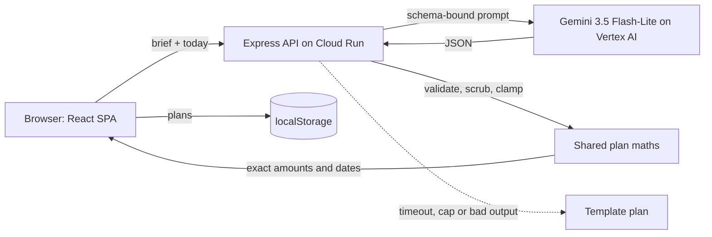

# Utsav: a GenAI planner for weddings, birthdays and community events

[](https://github.com/Ritesh-Root/utsav-planner/actions/workflows/ci.yml)

**Live app:** [https://utsav-planner-295478535981.us-central1.run.app](https://utsav-planner-295478535981.us-central1.run.app)

Utsav (Hindi for "celebration") turns a short brief into a complete, editable event plan: a **budget** split
by category, a **timeline** counted back from the date, a **vendor checklist** with what to ask and when to
book, **personalised ideas**, and a run sheet for the day. Google **Gemini on Vertex AI** drafts the plan and
refines it when you ask in plain words; Utsav's own code does every calculation, so the numbers always add up.

Built for PromptWars Virtual, Challenge 5 (Celebration & Event Planner), with Google Antigravity and Claude Code.

## Try it in 30 seconds

1. Open the live app and choose a sample: an Indian wedding, a 7-year-old's birthday or a Diwali community mela.
2. Press **Create my plan**. Gemini drafts the plan in about 8 seconds.
3. Tick a task, type a new amount for a budget line (the rest rebalance exactly), or try the guest-count what-if.
4. Press **Refine with AI** and ask "We now expect 20% more guests", see what would change, then **Apply** or
   discard. Every change can be undone.
5. **Export** the timeline to Google Calendar, Apple Calendar or Outlook, or print the plan.

## The brief, feature by feature

| The challenge asks for             | What Utsav does                                                                                                                                                                                                               | Code                                                                                    | Tests                                                                |
| ---------------------------------- | ----------------------------------------------------------------------------------------------------------------------------------------------------------------------------------------------------------------------------- | --------------------------------------------------------------------------------------- | -------------------------------------------------------------------- |
| A GenAI-powered planning assistant | Gemini drafts the whole plan as schema-bound JSON; follow-up requests refine only what changed, previewed before applying                                                                                                     | `src/server/ai/planner.ts`, `src/shared/plan.ts` (`mergeRefinement`)                    | `tests/server/planner.test.ts`, `tests/shared/plan.test.ts`          |
| Weddings                           | Multi-day weddings (pre-wedding functions, ceremony, reception), dietary and tradition-aware ideas                                                                                                                            | `src/shared/templates/wedding.ts`, prompts                                              | `tests/shared/insights-templates.test.ts`                            |
| Birthdays                          | Age-aware themes and activities, no alcohol for children's events, allergy-safe food                                                                                                                                          | `src/shared/templates/birthday.ts`, prompts                                             | same                                                                 |
| Community events                   | Permits, volunteers, safety, waste and step-free access built into tasks and vendors                                                                                                                                          | `src/shared/templates/community.ts`, prompts                                            | same                                                                 |
| Budgets                            | AI share per category turned into exact amounts (largest remainder), 5–15% contingency, lock a line and the rest rebalance, spent vs planned, per-guest cost, a guest-count what-if, AI estimate ranges labelled as estimates | `src/shared/budget.ts`, `src/client/panels/BudgetPanel.tsx`                             | `tests/shared/budget.test.ts` (500-case property test)               |
| Timelines                          | Tasks scheduled back from the date by lead time, phases, "do now" when the ideal date has passed, countdown, multi-day run sheet, `.ics` export and Google Calendar links                                                     | `src/shared/timeline.ts`, `src/shared/ics.ts`, `src/client/components/RoadToTheDay.tsx` | `tests/shared/timeline.test.ts`, `tests/shared/ics.test.ts`          |
| Vendor checklists                  | Vendor types (never business names), why each is needed, questions to ask, book-by dates, status pipeline, private notes and quotes, a Google Maps search to find real vendors nearby                                         | `src/shared/vendors.ts`, `src/client/panels/VendorsPanel.tsx`                           | `tests/shared/vendors-links.test.ts`, `tests/client/panels.test.tsx` |
| Personalised ideas                 | Themes, decor, food, activities and cultural touches tied to the brief, always with an accessibility and a sustainability idea; save, filter, "more like these"                                                               | `src/client/panels/IdeasPanel.tsx`                                                      | `tests/client/views.test.tsx`                                        |

**Responsible AI.** Utsav never names businesses or invents contact details (the schema has no field for them,
and a scrubber removes links, emails and phone numbers from model output). Costs are labelled as estimates. The
model never does arithmetic. If Gemini is slow, unavailable or returns something unusable, Utsav falls back to
a complete template plan and says so on screen, with a button to try AI again.

## How it works



- **One service:** an Express 5 API that also serves the Vite-built SPA (hash routing, so one HTML page).
- **Shared domain code** (`src/shared`) runs on both sides: zod schemas, budget apportioning, scheduling,
  vendor state, insights, iCalendar export, refinement merging and the template engine.
- **Gemini decides, code calculates.** The model returns shares and lead times; `finalizePlan` turns them
  into amounts that sum exactly to the budget and dates relative to the event, so edits recompute instantly
  without another AI call.
- **No accounts, no server-side storage.** Plans live in the browser; vendor contacts, quotes, notes and
  spending never leave it.

## Google services

| Service                                                               | Used for                                                                                          |
| --------------------------------------------------------------------- | ------------------------------------------------------------------------------------------------- |
| Gemini (`gemini-3.5-flash-lite`) on **Vertex AI** via `@google/genai` | Drafting plans and refining them, with structured JSON output, request labels and safety settings |
| **Cloud Run**                                                         | Hosting, with a dedicated service account that holds only `roles/aiplatform.user`                 |
| **Cloud Build** and Artifact Registry                                 | Building the container from source                                                                |
| **Google Calendar**                                                   | One-click "add to calendar" links for every task                                                  |
| **Google Maps**                                                       | A search link per vendor type near the event, to find real vendors                                |
| **Google Antigravity**                                                | Development: generated the three event illustrations and reviewed problem-statement alignment     |

There are **no API keys** anywhere: Cloud Run's service identity (and Application Default Credentials
locally) authenticate to Vertex AI.

## Quality, by the judging criteria

### Code quality

- TypeScript 6 in strict mode with `noUncheckedIndexedAccess`; ESLint 9 with typescript-eslint
  `strictTypeChecked`, React Hooks and jsx-a11y `strict`, run with `--max-warnings=0`; Prettier.
- Pure, documented domain functions with `today` passed in; side effects only at the edges. The server is
  built by `createApp(deps)` so tests inject a fake model.
- Every bound lives in `src/shared/limits.ts` and feeds validation, prompts and form `maxLength` alike.

### Security

- **Keyless:** Vertex AI through the service identity; least-privilege runtime service account.
- **Strict headers (helmet):** CSP `default-src 'self'` with no inline scripts or styles (fonts are
  self-hosted), HSTS, `frame-ancestors 'none'`, `nosniff`, `no-referrer`, COOP/CORP, Permissions-Policy.
- **Input:** JSON only (415), 32 KB cap (413), strict zod schemas that reject unknown keys (400 with field
  paths), a same-origin guard on writes (403), per-IP rate limits (120 requests per minute, 20 AI requests
  per 10 minutes, 429 with `Retry-After`).
- **Prompt injection:** user text is embedded as escaped JSON inside data tags; the model has no tools; its
  output is schema-bound, re-validated, cleaned and never rendered as HTML (`dangerouslySetInnerHTML` is
  banned by lint).
- **Cost on a public URL:** cache, in-flight de-duplication, a daily cap per instance, a circuit breaker,
  at most 3 instances and a billing alert.
- `npm audit`: 0 vulnerabilities. Semgrep (210 rules): 0 findings. Gitleaks: no secrets. See
  [SECURITY.md](SECURITY.md).

### Efficiency

- Gemini 3.5 Flash-Lite with low thinking: full plans in about 7–9 seconds, refinements in about 4.
- Identical requests are served from an LRU cache (6 hours) and concurrent duplicates share one call.
- Edits never call the AI: budgets and dates recompute locally.
- 100.6 KB of JavaScript (gzipped) for the first screen; every tab, view and the offline template engine
  load on demand; CSS 5 KB. `npm run budget:bundle` enforces these budgets in CI.
- Compression, immutable caching for fingerprinted assets, `no-cache` for the page shell.

### Testing

- **190+ tests** (Vitest) in a node project (shared domain, server, styles) and a jsdom project (client),
  hermetic: no network, no credentials, no build step, any time zone.
- Highlights: a 500-case property test that budgets always add up; iCalendar folding for Devanagari and
  emoji; a malicious model answer scrubbed of contacts; every API status code and security header;
  React Testing Library flows with axe-core; a token contrast test.
- Coverage gate: 85% of lines and 80% of branches (currently about 92% and 83%).
- Outside `npm test`: `npm run smoke:ai` (live Gemini), `npm run smoke:live -- <url>` and
  `npm run test:e2e -- <url>` (Playwright + axe in four display modes).

### Accessibility

- WCAG 2.2 AA throughout, and a **high-contrast mode** with every text pair at 7:1 or better (tested), a
  **simple reading** mode, dark mode, `forced-colors` and reduced-motion support.
- Skip link, landmarks, one `h1` per view with focus moved to it on navigation, WAI-ARIA tabs with arrow
  keys, native `<dialog>` with focus return, a focused error summary linking to each field, live regions
  for progress and results, status in words as well as colour, 44 px primary targets, reflow at 320 px.
- axe-core: 0 violations on every screen in light, dark and high-contrast themes and on a phone, in a real
  browser.

## Run it

```bash
npm ci
cp .env.example .env          # set GOOGLE_CLOUD_PROJECT, or AI_MODE=off for templates only
gcloud auth application-default login
npm run dev:server            # API on :8080
npm run dev                   # app on :5173, proxied to the API
```

`npm run check` runs lint, formatting, type checks, tests with coverage, the build and the bundle budget.

## Deploy

```bash
gcloud run deploy utsav-planner --source . --region us-central1 \
  --service-account utsav-runtime@PROJECT.iam.gserviceaccount.com --allow-unauthenticated \
  --max-instances 3 --cpu-boost --timeout 60 \
  --set-env-vars GOOGLE_GENAI_USE_VERTEXAI=true,GOOGLE_CLOUD_PROJECT=PROJECT,GOOGLE_CLOUD_LOCATION=global,GEMINI_MODEL=gemini-3.5-flash-lite
```

## Project layout

```
src/shared/   schemas, limits, budget, timeline, vendors, insights, ics, links, plan, templates, presets
src/server/   app (createApp), routes, security, errors, logger, config, ai/ (gemini, prompts, schema, normalize, planner, guards)
src/client/   App, router, api, storage, settings, state/, components/, panels/, views/, styles/
tests/        shared/, server/, client/, styles/, fixtures/
scripts/      smoke-ai, smoke-live, e2e, bundle-budget
```

## Credits

Illustrations generated with Google Antigravity (Gemini). Fonts: Instrument Sans and Instrument Serif,
SIL Open Font License (`src/client/styles/fonts`). Code under the [MIT licence](LICENSE).
